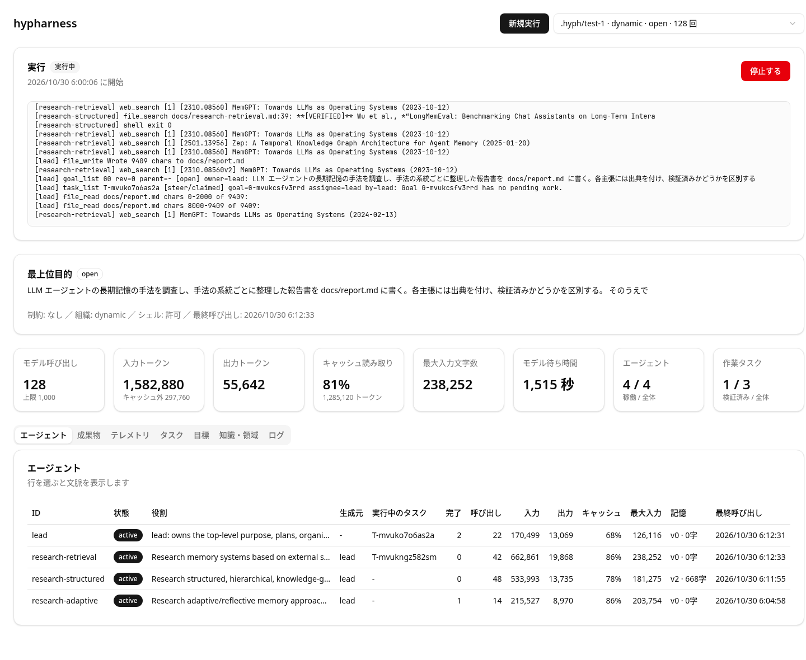

# hypharness

目的を1つ渡すと、複数の LLM エージェントが目標・タスク・知識・担当・人数を自分たちで組み替えながら作業し、別のエージェントが検証した成果物を作業ディレクトリに残すエージェントハーネスです。

ハーネスとは、モデルの呼び出し、ツールの実行、状態の保存を受け持つ実行基盤のことです。hypharness は「DeLM × CLM Core Specification」に沿って、組織全体で共有する目標・タスク・知識・担当領域（DeLM）と、各エージェントが持ち続ける文脈（CLM）を分けて SQLite に保存します。計画の手順は固定せず、待ち作業のない目標をその所有者に戻して次の手を決めさせる規則だけで、計画、分担、提出、差し戻しが進みます。止めても同じディレクトリから続きを再開でき、同じ目的を1体・固定の3体・自律的に増減する組織で解かせて比較できます。



上の画面は、「LLM エージェントの長期記憶の手法を調査し、報告書を書く」という目的を dynamic モードで実行している途中のダッシュボードです。lead が調査を3つの系統に分け、それぞれを担当するエージェントを生成しています。

- [必要なもの](#必要なもの)
- [導入と最初の実行](#導入と最初の実行)
- [基本の考え方](#基本の考え方)
- [使い方](#使い方)
- [設定](#設定)
- [安全性と制約](#安全性と制約)
- [うまくいかないとき](#うまくいかないとき)
- [開発](#開発)
- 詳しい資料: [仕組み](docs/architecture.md) / [ツール一覧](docs/tools.md) / [LoCoMo-Plus ベンチマーク](docs/locomo.md)

## 必要なもの

- [Bun](https://bun.com/)。1.4.4 で動作を確認しています。
- OpenAI のモデルを使える ChatGPT アカウント。モデルは [pi-ai](https://www.npmjs.com/package/@earendil-works/pi-ai)（複数の LLM 提供元を同じ形で呼び出すライブラリ）を通して、ChatGPT でのサインイン（OAuth）で呼び出します。動作はこの方法でだけ確認しています。
- Web 検索を使わせる場合だけ、[Parallel](https://parallel.ai/) の API キー。

動作を確認した環境は Linux（WSL2 上の NixOS）です。

## 導入と最初の実行

1. 依存パッケージを入れます。

   ```bash
   git clone https://github.com/mikan-919/hypharness.git
   cd hypharness
   bun install
   ```

2. ChatGPT でサインインします。ブラウザでの認証が終わると、認証情報がカレントディレクトリの `auth.json` に保存されます。hypharness はリポジトリ直下の `auth.json` を読むため、リポジトリ直下で実行してください。

   ```bash
   bunx @earendil-works/pi-ai login openai
   ```

3. 必要なら `.env` を作ります。Bun はプロジェクト直下の `.env` を自動で読み込みます。

   ```bash
   cp .env.example .env   # PARALLEL_API_KEY、OPENAI_MODEL、REASONING を必要に応じて書く
   ```

4. 小さな目的で実行します。`--check` に渡したコマンドは、終了後に作業ディレクトリで実行されます。

   ```bash
   bun run start 'hello.ts を作る。bun hello.ts を実行すると Hello, world! と1行出力する。' \
     --dir .hyph/hello --allow-shell --calls 40 --check 'bun hello.ts'
   ```

   実行中はエージェントごとのツール呼び出しが流れ、最後に検査コマンドの出力と結果の JSON が出ます。手元で実行したときの出力は次のとおりでした（モデルの応答によって手順と数値は変わります）。

   ```text
   [lead] file_list Empty
   [lead] goal_list G0 rev=0 parent=- [open] owner=lead: hello.ts を作る。…
   [lead] shell exit 0
   [lead] goal_complete Goal G0 submitted for verification
   [lead] task_finish Finished T-mvuksmi60i9h
   [verifier] file_read hello.ts chars 0-30 of 30:
   [verifier] shell exit 0
   [verifier] task_finish Finished T-mvukt5k91dfn
   Hello, world!
   {
     "status": "done",
     "rounds": 3,
     "modelCalls": 8,
     ...
     "agents": 2,
     "checkExit": 0
   }
   ```

   `status` が `done` なら、最上位の目標が別のエージェント（ここではホストが生成した `verifier`）の検証を通って完了しています。`checkExit` は検査コマンドの終了コードです。成果物は `.hyph/hello/workspace/hello.ts` にあります。

## 基本の考え方

| 用語 | 意味 |
| --- | --- |
| 目的（purpose） | 最初の起動時に渡す文。最上位目標 G0 になり、そのセッションでは変更できない |
| 目標とタスク | 目標は「何が成り立てば達成か」、タスクはその下の作業。目標には所有者がいる |
| steer タスク | 待ち作業のない目標を所有者に戻し、作業する・分ける・直す・提出するのどれかを選ばせるタスク。計画もこの規則から始まる |
| 検証 | 作業タスクの完了と目標の提出は、提出者以外のエージェントが成果物を確かめて合否を出すまで完了にならない |
| 知識と担当領域 | 知識は1行の要旨・説明・原資料と出典を持ち、検証されるまでは仮説として扱う。担当領域は知識への参照をまとめた管轄で、分割・統合・移譲できる |
| 作業記憶 | エージェントがタスクをまたいで持ち続ける唯一の文脈。本人だけが書き換えられ、他者は読むだけ |
| 組織の形 | `single`（1体）、`fixed`（lead・worker・reviewer の3体で固定）、`dynamic`（エージェントが生成と休眠を判断する。既定値） |

各エージェントは1回に1つのタスクを取り、ツールを呼びながら処理します。他のエージェントの動きは自動では入力に入らず、必要なときに `news` で差分を取ります。詳しくは [仕組み](docs/architecture.md)、エージェントが使える37個のツールは [ツール一覧](docs/tools.md) にまとめています。

## 使い方

### 実行して続ける

```bash
# 新しいセッションを始める（--dir を省くと .hyph）
bun run start 'CSVを集計するCLIを書き、テストを通す' --constraints 'TypeScriptのみ' --allow-shell --calls 80

# 同じセッションを続ける。目的は渡さない。--calls は累計なので、使った回数より大きくする
bun run start --allow-shell --calls 160

# 目標・エージェント・使用量を表示する
bun run start status
```

状態は `<--dir>/state.sqlite`、成果物は `<--dir>/workspace/`、各エージェントの文脈の写しは `<--dir>/contexts/<agent>.md` に置かれます。途中で Ctrl+C などで止めても、同じ `--dir` で起動すれば実行中だった作業から続きます。記録済みのツール呼び出しは繰り返しません。

### ダッシュボードで操作する

```bash
bun run dashboard                          # http://127.0.0.1:4321/ で開く
bun run dashboard --dir .hyph --port 4321
```

ダッシュボードは `--dir` の下にあるすべての `state.sqlite` をセッションとして一覧し、ブラウザから実行の開始・再開・停止と、経過の確認ができます。

- **新規実行**: 最上位目的、制約、セッション名、組織（single・fixed・dynamic、または3方式を比べる bench）、呼び出し上限、エージェント数と同時実行数の上限、終了後の検査コマンド、シェルの許可を指定して起動します。状態は `<--dir>/<セッション名>/` に保存されます。
- **実行の操作**: 実行中のセッションは停止でき、停止中のセッションは呼び出し上限（累計）・検査コマンド・シェルの許可を指定し直して再開できます。実行の出力は画面に表示され、セッションの `run.log` にも追記されます。ダッシュボードを終了すると、そこから起動した実行も停止します。
- **表示**: 状態ファイルは読み取り専用で開き、数秒ごとに再取得します。
  - 最上位目的と、呼び出し回数・入力トークン（キャッシュ分を含む）・キャッシュ読み取りの割合・1回の最大入力トークン数などの集計
  - エージェントごとの状態・役割・生成元・実行中のタスク・使用量。行を選ぶと、作業記憶とその履歴、実行中の文脈、過去のエピソードを表示する
  - 作業ディレクトリのファイル一覧と内容（成果物）
  - 呼び出しごとの入力文字数と入力トークンのグラフ、呼び出しの記録の表
  - タスク、目標、知識と担当領域、イベントログ

コマンドラインから起動したセッションも同じ `--dir` の下にあれば表示されます。画面は shadcn/ui（コピーして使う React の UI 部品集）と Tailwind CSS で作られ、Bun の HTML インポートで配信されます。Tailwind の変換は `bunfig.toml` で読み込む `bun-plugin-tailwind` が行います。

### フロントチャットで話す

```bash
bun run src/index.ts chat
```

ユーザーと話すモデル（フロントモデル）は、直近6件の発言だけをコンテキストに持ちます。それより前の発言は文ごとに分けて DeLM の knowledge に移し（1日1件の domain）、応答に必要なときだけ `knowledge_search` と `knowledge_get` で読みます。会話が長くなってもコンテキストは伸びません。発言と記憶は `.hyph/chat` に残り、ダッシュボードの「チャット」画面でも同じ会話を続けられます。各発言がコンテキスト内にあるか記憶へ移ったかと、直前の応答のモデル呼び出し回数とピーク入力トークンを表示します。

記憶の domain にはそれぞれ専用の担当エージェント（steward）がいて、普段は休眠しています。domain に前回の整理から12件以上の knowledge が増えると、トリガーが担当を起こして整理を頼みます。担当は話題ごとの分割（`domain_split`）、自分の担当どうしの統合（`domain_merge`）、他の担当の domain の譲渡依頼（`domain_request`）ができます。依頼を受けた担当は、譲るかどうかを自分で決めます。整理は応答を返した後に、1回あたり12呼び出しまでの予算で走ります。担当はファイルの書き込みやゴールの操作はできず、ほかの役は整理の仕事を取れません。LoCoMo の `-memory` 方式でも domain ごとの担当は作りますが、取り込みではトリガーを発火させないので、問題を解く呼び出しの予算は使いません。

### 組織の形を比べる

```bash
bun run bench 'ToDo管理のCLIを書く' --calls 60 --allow-shell --check 'bun test'
```

同じ目的・モデル・呼び出し上限で single、fixed、dynamic、market を別々のセッションで順に実行し、`.hyph/bench-<時刻>/report.json` に次の値を書きます。

- 終わり方と、最上位目標が独立に検証されたか
- 検査コマンドの終了コード
- モデル呼び出し数、入出力トークン数、キャッシュ読み取りトークン数、最大入力文字数、経過時間
- エージェント数と組織の変更数
- 集中度: モデル呼び出しのうち lead が使った割合（`leadShare`）と、1体の担当が持つ domain の最大数（`maxDomainsPerSteward`）

モデルの応答は実行ごとに変わるため、結果も実行ごとに変わります。差を見るには複数回実行してください。

market は、判断を lead に集めない組織です。エージェントは指示ではなくイベントで動きます。ツールがイベントを記録すると、`src/triggers.ts` の対応表に従って、そのイベントを扱う役にタスクができます。

1. lead はゴールを部分ゴールに分けて提出するだけです。ファイルの書き込み、シェル、タスクの作成、エージェントの作成はできません。
2. 部分ゴールができると（`goal_created`）、投資家役（investor）が `goal_fund` でモデル呼び出しの予算を付けるか、`goal_decline` で断ります。同じゴールの下で断れるのは3件までです。
3. 出資された部分ゴールは、予算つきの作業タスクになります。作業役（worker）が予算の範囲で行い、使い切ると作業は失敗となって投資家役に戻ります（`budget_exhausted`）。予算は作業のやり直しをまたいで数えます。
4. 終わった作業には批判役（critic）が異議を出します。異議がなければ合格です。異議があれば評価役（evaluator）が根拠を確かめて裁定し、認めた場合は作業が差し戻されます。批判役には、過去の異議が認められた数と退けられた数を毎回示します。

各役は必要になったときに作られ、仕事がなければ休眠します。判断が lead に集まっていないかは、ダッシュボードのエージェントの KPI にある lead の呼び出し割合と、自己改善の評価に記録される lead 比率とエージェント数で確かめられます。

### Web 検索を使わせる

`.env` などで `PARALLEL_API_KEY` を設定すると、エージェントは `web_search` ツールで Parallel Search API（`https://api.parallel.ai/v1/search`）に検索語を fast モード（速度を優先する検索の設定）で送り、関連順の URL と抜粋を受け取ります。キーがない起動では、このツールはモデルに渡すツールの一覧から外れます。検索結果はホストが URL を出典とする未検証の知識として自動で登録するため、エージェントは同じ内容を検索し直さずに `knowledge_search` で引けます。

### 自己改善を回す

```bash
bun run rsi                       # 止めるまで世代を続ける。状態は .hyph/rsi/
bun run rsi --generations 3 --calls 150 --per-category 3 --seed 1 --delta 0.05 --parallel 6
```

ダッシュボードの「自己改善」からも開始・停止でき、世代ごとの点数とピーク入力トークン、判定、改善役のメモ、ループのログを表示します。1世代は次の順に進みます。

1. 採用中のハーネスのコミットから git worktree（同じリポジトリの別ブランチを別ディレクトリに展開したもの）を `.hyph/rsi/gen-N/workspace` に作り、ブランチ `rsi/gen-N` に切り替える。
2. 採用中のハーネスの評価記録を worktree の `rsi-traces/` に置く。中身は、各問題のエージェントの文脈の写し、判定、過去の世代の予測と結果、各問題のツール呼び出しを1回ずつ並べた `trace.md`（引数、結果の大きさかエラー、その時点の入力トークン。`context_edit` で消えた手順も含む）、全問題を集計した `diagnostics.md`（ツールごとの回数・エラー・結果の大きさ、一度も呼ばれないツール、何も見つからなかった検索、同じ呼び出しの繰り返し、エピソードの終わり方、`context_edit` と作業メモの更新の回数）。既定の目的は、改善役にこれらを使って CLM（作業メモとライブコンテキストの扱い）、ツールの使い方、組織、誤答の原因、コンテキスト長（ピークを押し上げた呼び出し）、記憶からの検索（`-memory` 方式）、market の役（予算と使用量、批判の採否）の順に診断させ、最も多い原因に1か所の変更で対処させる。同じ診断はダッシュボードでも見られる。自己改善の「世代の詳細」では各世代の評価の全問を、セッション画面の「診断」タブではそのセッションを、ツールごとの集計、問題のある呼び出し、CLM の表、呼び出しの記録として表示する。
3. 採用中のハーネスが dynamic のセッション（シェル許可、`--calls` まで）で自分のソースを1か所改善し、変更内容と予測を `rsi-traces/note.md` に書く。変更はブランチにコミットされる。
4. `scripts/rsi-eval.ts` が候補をコピーし、`src/locomo.ts` を元のリポジトリのものに差し替え、型検査とテストを通したうえで、LoCoMo-Plus の固定したサブセット（分類ごとに `--per-category` 問、種 `--seed`）を dynamic で解かせる。点数と、1問ごとの最大入力トークンの平均（ピーク平均）を測る。
5. 点数が採用中より `--delta` を超えて下がれば不採用。`--delta` を超えて上がれば、ピーク平均の増加が点数の増分の割合以内なら採用。差が `--delta` 以内なら、ピーク平均が5%以上下がった場合だけ採用。採用された候補が次の世代の改善役になる。

評価では問題ごとに別のセッションを立て、`--parallel` 問を同時に解きます（既定は全問）。モデル提供元の利用上限に当たる場合は小さくしてください。最初の世代（0）は現在の HEAD を評価してベースラインにします。モデルの失敗などで止まった段階は10分後に同じ場所から再開し、プロセスを止めても同じ `--dir` で続きから動きます。採用された変更は `rsi/gen-N` ブランチに残るだけで、`main` には取り込みません。取り込むときは差分を読んでからプルリクエストにしてください。改善役はシェルを使えるため、[安全性と制約](#安全性と制約)のシェルの注意がそのまま当てはまります。1世代のモデル呼び出しは、改善に `--calls` 回、評価に問題数×1問あたり約20回（既定の18問で約400回）です。

改善役に渡す目的と制約は `--purpose` と `--constraints`、改善役の組織は `--mode`、評価の1問あたりの呼び出し上限は `--eval-calls`（既定40）で変えられます。ダッシュボードの「自己改善」画面でも、停止中に同じ項目を編集して開始・再開できます。指定しなかった項目は前回の開始時の値を引き継ぎ、初回は `scripts/rsi-defaults.ts` の既定値を使います。目的・制約・組織は新しく始まる世代から反映されます。`--per-category`、`--seed`、`--eval-calls` は世代間で同じ条件で比べるため、初回の開始で固定されます。`--parallel` と `--generations` は引き継がず、開始ごとに指定します。

`--judges on`（既定）では、変更の価値を3つの役で判定します。改善の前に投資家役が履歴と採用中の評価を読み、掘る方向、理由、予測、改善役の呼び出し予算（`--calls` 以内）を決めて改善役に伝えます。方向は候補が変更したテスト以外のファイルの組で数え、2世代続けて不採用になった方向は閉じます。閉じた方向だけを変えた候補は評価せずに不採用にします。評価で機械的な採用規則を通った候補には、批判役が最大3件の異議を出し、評価役が各異議を認めるか退けるかを裁定します。認めた異議があり評価役が却下した場合だけ不採用にします。比べる相手は採用中のハーネスだけです。3つの役は改善役が書き換えられない元のリポジトリの `scripts/rsi-judges.ts` からモデルを直接呼び（market 組織の同名の役とは別物です）、機械的な規則で不採用になった候補を採用に変えることはありません。批判役には過去の異議が認められた数と退けられた数を毎回示し、根拠のない異議を出さないようにしています。

### LoCoMo-Plus で測る

```bash
bun run src/index.ts locomo --arms direct,dynamic --per-category 2
```

長期会話の記憶を問う [LoCoMo-Plus](https://github.com/xjtuleeyf/Locomo-Plus) の問題を、モデルへの1回の呼び出しとハーネスで解かせ、LLM で採点して比べます。問題の組み立てと採点は参照実装を移植しています。データの扱い、オプション、出力、比較の注意、測定例は [LoCoMo-Plus ベンチマーク](docs/locomo.md) にあります。

`--arms` に `dynamic-memory` のように組織名と `-memory` をつないだ方式を加えると、会話をファイルで渡す代わりに DeLM の記憶として渡す方式も測れます。会話を句読点で文ごとに分け、1文を1件の knowledge（検証済み）として記録し、セッションごとに domain を作ります。エージェントは会話のファイルを持たず、`knowledge_search` と `knowledge_get` で必要な文だけを引きます。取り込みは `src/memory.ts` にあり、モデルを呼びません。自己改善ループでは `--arm dynamic-memory` でこの方式を評価対象にできます。

## 設定

### 実行のオプション

`bun run start`（`src/index.ts`）と `bun run bench` に共通のオプションです。

| オプション | 意味 | 既定値 |
| --- | --- | --- |
| `--dir DIR` | セッションのディレクトリ | `.hyph` |
| `--mode single\|fixed\|dynamic\|market` | 組織の形。最初の起動時に固定される | `dynamic` |
| `--constraints TEXT` | 目的とともにシステムプロンプトに入る制約 | なし |
| `--calls N` | モデル呼び出し回数の累計上限。状態に保存され、再開時に指定すると上書きされる | なし |
| `--agents N` | エージェント数の上限（single では常に1） | なし（fixed は `3`） |
| `--concurrency N` | 同時に実行するエピソード数の上限（single では常に1） | なし |
| `--allow-shell` | `shell` ツールを許可する。起動ごとに判断し、指定しない起動では拒否される | 許可しない |
| `--rounds N` | スケジューラーの巡回回数の上限 | なし |
| `--check 'CMD'` | 終了後に作業ディレクトリで実行する検査コマンド。終了コードを `checkExit` に入れる | なし |

### 環境変数

| 変数 | 意味 | 既定値 |
| --- | --- | --- |
| `OPENAI_MODEL` | 使うモデルの ID | `gpt-6-sol` |
| `REASONING` | 推論の強さ（`minimal`、`low`、`medium`、`high`、`xhigh`、`max`） | `medium` |
| `PARALLEL_API_KEY` | Parallel の API キー。ないと `web_search` を提供しない | なし |
| `MODEL_TIMEOUT_MS` | 1回のモデル呼び出しを打ち切るまでの時間（ミリ秒） | `300000` |

1タスクの手数（16）、作業記憶の上限（6000文字）、ツール出力の上限（4000文字）、タスクの取得期限（10分）などの内部の値は、[`src/db.ts`](src/db.ts) の `defaultConfig` で決まっています。

## 安全性と制約

- **シェル**: `--allow-shell` を付けた起動では、エージェントが作業ディレクトリでシェルコマンドを実行できます。サンドボックス（実行範囲を隔離する仕組み）はなく、コマンドは作業ディレクトリの外にも触れられます。信頼できる環境でだけ許可してください。ファイル系ツール（`file_read` など）は、作業ディレクトリの外を指すパスをシンボリックリンク経由も含めて拒否します。
- **ダッシュボード**: シェルを許可した実行を起動できるため、`127.0.0.1` でのみ接続を受け付けます。加えて、次の要求を拒否します。利用者の認証はないため、外部に公開しないでください。
  - Host ヘッダーが自身でない要求（DNS リバインディング: 外部のドメイン名をローカルのアドレスに向けてブラウザ経由で接続させる攻撃）
  - Origin ヘッダーが自身でない、または JSON でない変更要求（CSRF: 別のサイトからブラウザに要求を送らせる攻撃）
- **認証情報**: `auth.json` と `.env`、セッションの `.hyph/` は `.gitignore` の対象です。コミットや共有をしないでください。
- **1プロセス**: 1つのセッションは1つのプロセスで動かす前提です。同じディレクトリを複数のプロセスで同時に開くと、実行中エピソードの再開が衝突します。ダッシュボードは自分が起動した実行の重複は防ぎますが、コマンドラインから同じセッションを同時に実行した場合は検出できません。
- **費用**: モデル呼び出しは ChatGPT の利用枠を消費します。呼び出し回数・エージェント数・同時実行数・巡回回数は既定で上限がなく、目標が完了するか、進められなくなるか、エラーで止まるまで続きます。dynamic は生成したエージェントの分だけ呼び出しが増えます。必要に応じて `--calls` などで上限を決めてください。

## うまくいかないとき

| 症状 | 原因と対処 |
| --- | --- |
| `ENOENT: no such file or directory, open './auth.json'` | カレントディレクトリに `auth.json` がない。リポジトリ直下で `bunx @earendil-works/pi-ai login openai` を実行するか、リポジトリ直下から起動する |
| `ChatGPTでのログインが必要です` | `auth.json` に OpenAI の認証情報がない。上と同じ方法でサインインする |
| `未対応のモデル: …` | `OPENAI_MODEL` の ID を pi-ai が知らない。値を確かめる |
| `This store already has a different purpose` | 既にある `--dir` に別の目的を渡した。続けるなら目的を省き、新しく始めるなら別の `--dir` を使う |
| 結果の `status` が `budget` | 呼び出しの累計が `--calls` に達した。より大きい `--calls` を付けて同じ `--dir` で再開する |
| 結果の `status` が `error`、またはログに `stopping after 3 rounds in which every episode failed` | すべてのエピソードが失敗し続けた。利用上限、認証の期限切れ、通信障害が考えられる。ログの `error:` 行を確かめ、解消してから同じ `--dir` で再開する |
| 結果の `status` が `stalled` | 取れるタスクがなく、検証も手配できない。`bun run start status` やダッシュボードの目標とタスクを見て、残っている目標を確かめる |
| 作業ディレクトリの外のファイルを読ませたい | ファイル系ツールは作業ディレクトリの外を拒否する。必要なファイルを `<--dir>/workspace/` にコピーしてから始める |

## 開発

```bash
bun run check   # 型検査
bun test        # 擬似プロバイダーによるテスト（外部のモデルを呼ばない）
```

テストは、目的だけからの計画・実行・独立検証・完了、検証のためだけに組織が変わること、停止後の再開でツールの副作用が重複しないこと、作業量を増やしても入力が増えないこと、作業ディレクトリ外へのパスの拒否、モデル呼び出しの時間切れ、Web 検索の送信内容、ダッシュボードの要求の検査、LoCoMo-Plus の問題の組み立てと再開を確かめます。

ソースの構成と内部の動きは [仕組み](docs/architecture.md) にあります。変更の進め方（Issue からプルリクエスト、マージまでの流れ、検証と報告の決まり）は [AGENTS.md](AGENTS.md) に書いています。

## ライセンス

ライセンスはまだ設定していません。
