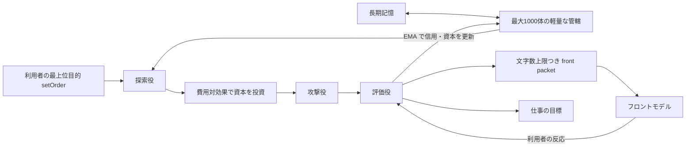

# 常駐する DeLM の仕様

hypharness を、目的を1つ渡して終わる「1回の実行」から、1つの DeLM が常時バックグラウンドで動き続ける形に作り変える。利用者が触れるのはチャット画面だけである。既存の仕組み（lead、1日1 domain の記憶、巡回ごとの待ち合わせ、目的の固定など）は、この仕様と食い違うなら捨ててよい。

## 全体

- 利用の状態は1つの store（`.hyph/main/state.sqlite`）だけに置く。セッションの区別はない。LoCoMo、`rsi` の測定用の store は、今のまま別に作る（比較には空の状態から始める必要があるため）。
- 1つのプロセスが常駐し、次の3つを並行に動かす。チャットの受付、記憶市場のループ、仕事のワーカープール。
- 常駐プロセスは `bun run src/index.ts serve`（名前は任意）で起動し、ダッシュボードのチャット画面から使う。`bun run start '<目的>'` は新しいセッションを作らず、常駐している DeLM への `setOrder` として扱う。
- モデル呼び出しの上限は設けない。利用枠のエラー（`usage limit` など、再試行しても通らないもの）は再試行で数えず、時間を置いて待つ。

## 最上位目的と setOrder

- 最上位目的は可変である。利用者だけが `setOrder` で変えられる。エージェントは変えられない。
- `setOrder` は meta の目的を書き換え、`order_changed` イベントを記録する。G0 を残す場合は、その説明文も同時に書き換え、rev を上げる。
- 既存の下位目標は消さない。`order_changed` で、開いている各目標の所有者に steer タスクを作り、新しい目的に照らして残す・直す・破棄するを選ばせる。
- 実行中のエピソードは止めない。新しい目的は次のエピソードのシステムプロンプトから入る。

## lead を置かない

- lead は作らない。目的を上から分解する役はいない。G0 は所有者を持たず、steer も提出もされない（G0 自体を持たない作りでもよい）。
- 仕事（目標）は、記憶市場の提案からだけ生まれる。探索役が案を出し、投資家役が出資し、攻撃役と評価役を通った案が最上位の目標になる。所有者は、案を出した探索役か出資した投資家役である。
- 以降の steer、分割、検証は、目標の所有者が担う。分解は、各所有者が自分の目標の範囲でだけ行う。検証は提出者以外が行う（既存の規則と同じ）。
- `setOrder` の後は、関連度の順位が変わることで新しい目的に近い案に資本が流れる。計画を立て直す役はいない。
- lead を前提にした箇所（`src/db.ts` の lead の生成、スケジューラーの休眠の例外、`leadShare`、market の起点）は外す。

## ワーカープール

- 巡回ごとに全員のエピソードの終了を待つ方式をやめる。エピソードが終わった枠から、次の仕事を割り当てる。同時実行数の上限は残す。
- 仕事がないときは終了せず、イベント（発言、`setOrder`、記憶市場からの新しい目標、トリガー）が来るまで待つ。

## 記憶市場（#113 を土台にする）

以下は #113「Surprise DeLM memory market」の仕様を、この常駐の形に合わせて直したものである。

### 問いと仮説

長い会話記憶をフロントモデルへ残さず、最大1000体の軽量な記憶管轄エージェントへ分配しても、限られた文字数の中で関連性と意外性のある応答材料を回収できるか。記憶の管轄を分割・統合し、目的関連度、意外性、反証耐性、費用対効果によって探索予算を配分すると、同じ短いフロント文脈でも複数の記憶を組み合わせた候補を残せる可能性がある。

### 構造

- 記憶市場は、スケジューラーとは別の常駐ループで動く。各役はタスクとエピソードを作らず、LLM を直接呼ぶ（`scripts/rsi-judges.ts` と同じやり方）。使用量は `usage` 表に記録する。
- 記憶片は `knowledge`、管轄は `domains` と `domain_knowledge` の表を使う。管轄の軽量な状態（`mandate`、信用、資本、戦略）は新しい表に持ち、`agents` の行にはしない。
- 1000体は1000回の LLM 呼び出しを意味しない。普段は軽量な状態として保ち、市場が投資した少数の案だけが攻撃と評価を受ける。
- すべての記憶片は、常にちょうど1つの管轄に属する。フロントの窓から外れた記憶も削除しない。

### 記憶の取り込み

- 利用者の発言とフロントの応答は、届いた時点で文に分け（句点・感嘆符・疑問符・改行。既存の `src/memory.ts` の分割でよい）、記憶片にし、埋め込みを計算して管轄に入れる。原文を欠落・改変しない。
- 直近6件の発言は、窓と記憶の両方にある。front packet を作るときは、窓にある記憶片を材料から外す。`chat` 表の `remembered` に相当する値は「窓から外れたか」を表す。

### 距離

- 記憶どうしの距離は、ローカルで動く多言語の埋め込みモデルで測る。日本語の言い換え（例:「犬を飼い始めた」と「ペットの世話」）を近いと判定できることを確かめる。埋め込みは記憶片ごとに1回計算し、SQLite に保存する。
- 埋め込みは差し替えられる口（関数かインターフェース）の後ろに置く。テストでは決定的な擬似の埋め込みを使い、ネットワークやモデルのファイルに依存しない。
- 文字 n-gram は距離の主な手段にしない（言い換えを拾えず、意外性と逆を向くため）。

### LLM を呼ぶ段階と呼ばない段階

| 段階 | 方法 |
| --- | --- |
| 記憶の分割 | 規則（LLM なし） |
| 管轄の分割と統合の候補 | 埋め込みの距離（LLM なし） |
| 探索 | 埋め込みの距離。近い組み合わせに加えて、遠い組み合わせも一定の割合で混ぜる |
| 攻撃: 単一根拠、既存の発見との重複 | 機械的に判定（重複は埋め込みの距離） |
| 攻撃: 目的との弱い接続、新しい根拠の欠如 | 評価役の LLM に含める |
| 評価 | LLM。対象の案と、順位の直前・直後の案だけを受け取る。全案は文脈に入れない |
| `mandate` の見直し、担当の再編の判断 | LLM（投資を受けたとき） |

- 期待収益/費用が下限未満の案には投資しない。
- 目的関連度は保存せず、探索のたびにその時点の最上位目的に対して計算する。`setOrder` の後、`mandate` は一斉に書き換えず、次に投資を受けたときに見直す。信用と資本の EMA はリセットしない。

### 担当の再編

- 距離は候補を出すだけで、再編を決めるのは担当本人である。ホストは「この境界で2つに分けられる」「あの管轄と近い」といった候補を作るが、自分では変えない。
- 担当は、投資を受けたときに候補を見て、分割・統合の申し入れ・譲渡の依頼・何もしない、のどれかを選ぶ。
- 休眠中の担当は再編しない。管轄が上限の大きさか距離の散らばりを超えたときだけ、担当を起こして判断させる。
- 総エージェント数は変えず、未使用の個体を分割先にする（最大1000体）。

### front packet

- フロントは、検索ツールで自分から引く代わりに、記憶市場が作った front packet を受け取る。packet は「最上位目的」「仮説」「記憶ID」「反証」「原文抜粋」だけを含み、文字数の上限を超えない。
- 参照ツール（`knowledge_search` と `knowledge_get`）は、packet に足りないときの予備として残す。
- フロントの文脈は、直近6件の発言と packet だけである。フロントは話すだけで、依頼の判定や仕事の割り当てをしない。

### 依頼の検出と成果

- 普段の発言に含まれる依頼は、記憶市場の探索が見つけ、提案として扱う（専用の判定はしない）。すぐやってほしいことは、利用者が `setOrder` で明示する。
- 目標が検証を通って完了したら、提出物の要旨を、出典（目標 ID とファイル）つきの記憶片として記録する。記憶市場はこれを他の記憶と同じく材料にする。
- `setOrder` の目的に直接ぶら下がる目標（最上位の目標）が完了したときだけ、フロントが利用者の発言を待たずに、チャットへ1件の報告を書き込む。

### 価値の基準（内部の資本主義）

外部のベンチマークでは測らない。内部の資本が基準である。資本が評価役の好みだけで回らないよう、利用者を最終的な買い手として扱う。

- packet に入った案が応答に使われ、その後の利用者の発言がその内容を受けて続いたら、その案の価値を上げる（評価役が判定する）。
- 利用者が否定・訂正したら、その案の価値を下げる。
- `setOrder` で頼まれた目標に寄与した案は、その目標の完了時に価値を上げる。
- 評価役も信用を持つ。評価役が高く付けた案が利用者の反応で下がったら、評価役の信用を下げる。

### 市場の内側の自己改善

- 改善の対象はコードではなく、各管轄・各役が持つ戦略（探索の方針、`mandate`、出資の基準を書いた短い文）である。
- 資本の多い戦略を LLM が変異させて、新しい個体か休眠中の個体に与える。資本の少ない戦略は淘汰される。評価役と資本の計算はコードの側にあり、戦略からは変えられない。
- コードの自己改善（会話の記録を再生して、利用者が後で触れた記憶が直前の packet に入っていたかを数える評価）は、この変更では作らない。

### 保存と再開

記憶、管轄、資本、発見、乱数の状態は SQLite に保存し、プロセスを止めても同じ store から続きを動かせる。

## ツール

- `web_fetch` を足す。http と https の URL だけを受け付ける。HTML は Bun の `HTMLRewriter` でタグを除いて本文にする（新しい依存を足さない）。結果は `web_search` と同じく、URL を出典とする未検証の知識として自動で登録する。ツール出力は既存の上限（4000文字）で切り、全文は知識の raw に入れる。ループバックアドレスとプライベートアドレス（名前解決した結果も含む）への接続は拒否する。`PARALLEL_API_KEY` がなくても提供する。

## MCP サーバーのツール

エージェントは、ホストが設定した外部の MCP サーバー（Model Context Protocol でツールを提供するサーバー）のツールを使える。hypharness は MCP クライアントになる。

- 設定は store のディレクトリの `mcp.json` に、Claude Code と同じ形式で書く。`{"mcpServers": {"<名前>": {"command": "...", "args": [...], "env": {...}}}}` は stdio、`{"type": "http", "url": "...", "headers": {...}}` は Streamable HTTP で接続する。ファイルがなければ MCP のツールは提供しない（測定用の store には置かない）。
- 起動時に各サーバーへ接続し、ツールの一覧を取る。ツールは `mcp__<サーバー名>__<ツール名>` の名前で、サーバーが返した説明と入力スキーマのまま、エージェントのツール一覧に加える。接続に失敗したサーバーはログに理由を出して外し、他のサーバーとハーネスは動き続ける。切断されたら次の呼び出しの前に接続し直す。
- 呼び出しの結果はテキストにし、既存のツール出力の上限で切る。全文は、出典を `mcp:<サーバー名>/<ツール名>` とする未検証の知識として自動で登録する（`web_search` と同じ扱い）。エラーはツールのエラーとして返す。
- stdio のサーバーは、シェルと同じ bubblewrap の中で起動する。workspace を作業場所にし、ネットワークは許可し、ホームディレクトリ、`auth.json`、`.env` は見せない。環境変数は `mcp.json` の `env` に書いたものだけを渡す。`bwrap` がない環境では stdio のサーバーを起動しない。
- HTTP のサーバーには、`mcp.json` に書いた URL へそのまま接続する（プライベートアドレスでも拒否しない。設定はホストの判断である）。
- 実装には `@modelcontextprotocol/sdk` を使う（プロトコルを自前で書かない）。テストは、テスト内で起動する擬似の stdio サーバーで行い、外部に接続しない。

## シェルのサンドボックス

- `shell` ツールのコマンドは bubblewrap（`bwrap`）の中で実行する。書き込めるのは workspace だけにする。ホームディレクトリ、`auth.json`、`.env`、リポジトリのほかの場所は見えなくする。ネットワークは許可する。
- `bwrap` がない環境では `shell` を提供しない。

## 守ること

- Bun を使う（`bun test`、`bun run check`、`bun:sqlite`、`Bun.serve`）。新しい依存は埋め込みモデルのためのものに限る。
- テストは擬似のプロバイダーと擬似の埋め込みで動き、外部のモデルやネットワークを呼ばない。
- README と `docs/architecture.md` を新しい形に合わせて書き直す。
