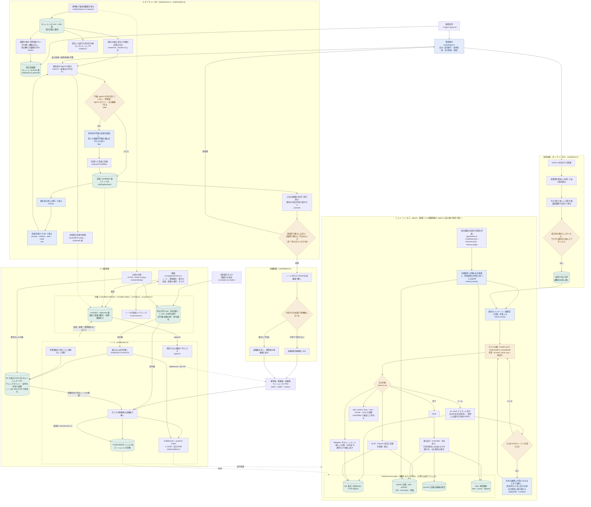

# 実装した構成

[flow.md](flow.md) の目標の図に対して、実際に作ったものを同じ3部（①メインハーネス・②オフライン RSI・③分散基盤）で示す。各ノードの括弧内は、その処理があるファイルと関数である。目標の図にあって作っていないものは、最後の表にまとめる。

## 目標の図との違い

| 目標の図の要素                                                                 | 実装                                                                                                                                                                                 |
| ------------------------------------------------------------------------------ | ------------------------------------------------------------------------------------------------------------------------------------------------------------------------------------ |
| A. 永続記憶（LCM 原文・DeLM 共有記憶と自己記憶・索引・参照グラフ・管轄の統合） | `agent/memory.ts`。原文・記憶・根拠・参照関係を `/state/memory.sqlite` に置く。管轄の分割・統合は、要旨の3文字組の一致率 0.6 以上で統合することだけで行う                            |
| B. 文脈選択（VISTA・RECAP 代替）                                               | 全文検索の順位・参照のつながり・評価で並べる。埋め込みによる意味検索はない（隔離環境から埋め込みの API を呼ぶ経路がない）                                                            |
| C. 作業文脈（CLM・TokenPilot）                                                 | 編集はモデルが提案し、検証して貯め、圧縮のときにまとめて反映する。作業メモは最初のメッセージに置く                                                                                   |
| D. 推論・実行（子エージェント）                                                | `delegate` は親だけが使え、子は1段まで                                                                                                                                               |
| E. オンライン RSI                                                              | 2つある。実行中は、課題の成否で記憶の評価を上下させ、3回失敗に関わった記憶を外す（`memory.judge`）。期ごとには、`node/ideas.ts` の経済のループが方針を検証用課題で測って採否を決める |
| DeLM（目的分解・担当選択）                                                     | `delegate` による部分目的の切り出しだけ。複数の担当エージェントを選ぶ仕組みはない                                                                                                    |
| ② A〜C                                                                         | 図のとおり。SpecForge は改善対象 `spec` と `agent/SPEC.md`、RRSI の批評は `filter`                                                                                                   |
| ② META                                                                         | 自動では採用しない。改善役が `META.patch` を書くと提案として残り、画面か `approve` で承認すると PR になる                                                                            |
| ② D 配備・復旧                                                                 | 図のとおり（`node/deploy.ts`）                                                                                                                                                       |
| ③ Scheduler                                                                    | 中継の待ち行列が、接続中で実行権を持たないノードに先頭から割り当てる。1ノードに1つまで。計測の試行は `HYPH_TRIALS=relay` のときだけ中継に置く                                        |
| ③ CAS・確定チェックポイント                                                    | R2 に内容のハッシュで置く。Git は候補のコミット（`refs/hypharness/`）に使う                                                                                                          |
| ③ Agent State                                                                  | ノードの `~/.hyph/state/<セッション>` に置き、チェックポイントには入れない。別のノードで再開したタスクは、そのノードの状態で続ける                                                   |
